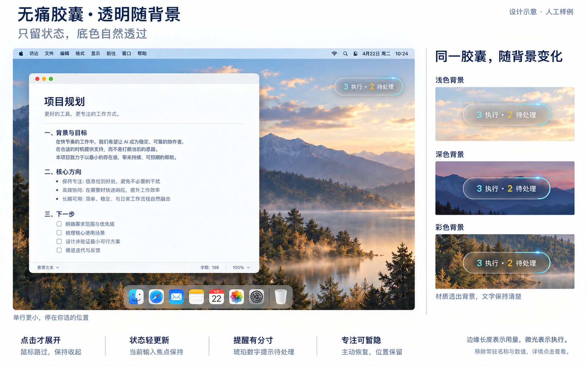

# 无痛胶囊产品与交互方案

更新日期：2026-10-15。适用于 AgentWatch 的 macOS 桌面挂件。

用户希望在照常工作的同时，一眼知道有哪些 Agent 正在执行、哪些需要自己处理。胶囊应以尽可能小的存在感提供这些信息。**看一眼就够了，工作照常。**

本轮交付设计方案和实施交接，尚未实现桌面窗口、真实透明或动画。本文区分用户已确认的方向与可供实施的默认参数。下一会话按 [实施交接](DESKTOP_CAPSULE_HANDOFF.md) 开始。

## 1 用户已确认的设计

| 项目 | 最终要求 |
| --- | --- |
| 形态 | 桌面单行胶囊，无图标，可自由拖动并靠边吸附，不限定在顶部 |
| 核心理念 | 不影响正常工作，保持安静、轻巧、容易忽略又随时可看 |
| 常驻文字 | 执行数与待处理数，例如 `3 执行 · 2 待处理` |
| 已移除内容 | 品牌图形、Agent／平台名称、文字版用量、百分比、第二行额度说明 |
| 材质 | 真正透出后方壁纸或窗口的半透明玻璃，随背后内容自然变化；减轻固定蓝灰蒙层 |
| 额度线 | 细线沿胶囊完整轮廓表示已用额度比例，运行、等待、空闲时都保留 |
| 额度含义 | 完整闭环表示额度已用 100%，不表示任务完成 |
| 执行动效 | 有已确认执行时，仅在已点亮的额度线内部流动；额度线起终点与长度保持不变 |
| 空闲表现 | 额度线保留，流光停止；没有执行也可能还有待处理事项 |

最新版视觉参考：

图片由 ImageGen 生成，全部是人工样例。它表达形态、层级和背景融合方向，不能证明真实桌面透明、背景自适应、位置避让或焦点行为已经可用。字体、尺寸、透明度和微光强度以实际 macOS 验收为准。

此前的黑色胶囊、三条柱形标志、常驻 `Codex 周额度 已用38%` 和大型常驻展开面板均已被本版取代。品牌图标另行探索，不阻塞无图标版本。

## 2 第一版范围

### 2.1 需要交付

1. 可在本机运行的原生 macOS 单行悬浮胶囊，以及可重复执行的构建、启动、退出方式。
2. 使用现有 Python 服务的状态与订阅数据，保留原 Web 看板入口。
3. 原生背景混合材质、额度描边与温和的局部流光。
4. 点击展开的轻量详情，包含待处理会话、状态来源／新鲜度、额度口径与完整看板入口。
5. 拖动、贴边吸附、位置恢复、多屏变化处理、主动暂隐与恢复。
6. 演示与真实模式的清楚区分，异常、未知、旧值和过期额度的完整空态。

### 2.2 保持现有边界

采集、数据库、配置增强、客户端信任、批准策略和原应用导航继续由既有后端负责。回复与批准由用户在原客户端完成。挂件不接管 Agent 工作，不保存对话内容。

开机自启、全局快捷键、跨平台桌面端、品牌图标、自动切换额度来源和系统通知不是本版完成条件。暂隐的恢复入口必须有；可先使用普通文字菜单栏项，避免把图标设计作为依赖。

## 3 默认交互提案

以下是为了让新会话可以实施而给出的默认值，属于方案选择，不是用户逐项指定的参数。

### 3.1 收起与展开

- 常态只显示 `执行数 执行 · 待处理数 待处理`，不放新图标、第二行、名称或百分比。
- 点击胶囊才展开。鼠标路过不展开；状态变化不改变窗口焦点或自动打开面板。
- 初次出现与之后更新都保持当前应用、光标和键盘输入目标。
- 展开面板优先列出等待回复、等待批准与异常，再列执行中的主会话。每个状态保持独立名称；明确的子 Agent 在父会话内查看。
- 上述分类针对已加载的会话逐条展示，不承诺当前接口没有提供的全量待回复／待批准分类数。主列表截断、子树未加载或某父会话存在子待处理摘要时保留对应提示，不能用可见行数证明待处理已经列全。
- 展开层可以显示会话名称、平台、额度数值、来源窗口和更新时间；“去掉名称与文字用量”针对常驻胶囊，不删除用户主动查看时所需的解释。
- 点击外部或明确收起时关闭面板，并让该次点击与键盘输入继续作用于原应用。避免把“点外部收起”实现为吞掉用户的工作点击。
- 名称修改与接入配置仍在完整 Web 看板完成，轻面板首版不增加文本输入框。

### 3.2 移动、吸附与专注

- 初始建议尺寸约 210–220 × 36–40 pt；字体约 12–13 pt。允许为多位数、异常文案和辅助功能适当增宽，保持单行。
- 初次放在可用屏幕右上区域的内侧，避开菜单栏和屏幕角；位置可完全由用户改变。
- 拖动距离超过约 4 pt 才进入移动，拖动结束不触发展开。松手后距离边缘约 12–16 pt 内可轻吸附，保留可见间隙与可抓取区域。
- 常态贴边仍保留完整单行胶囊。只剩一颗灯的侧签和 hover 自动展开不是本版默认行为。
- 保存屏幕标识与相对可用区域的位置。分辨率、缩放、显示器拔插后将位置夹回可见范围；位置不跟随鼠标或当前应用自行移动。
- 用户主动暂隐后，事件到达不自行恢复。提供明确的“显示胶囊”“重置位置”和退出入口。
- 原生全屏中保持收起，不自动弹层；Spaces、全屏应用和多屏属于必须单独验证的窗口行为。不要为了覆盖所有系统界面而使用过高的窗口层级。

### 3.3 提醒与材质

- 需要处理时，用琥珀色数字提示；普通更新保持无声、不震动、不弹到前台。
- 确认执行时，额度段内只有细小、低对比的高光，建议 4–6 秒一轮；静止时仍能读到额度长度。
- 保持材质中性，透出后方实际内容。透过一张事先保存的壁纸、固定蓝灰渐变或页面背景，不算“跟随桌面透明”。
- 使用系统材质与语义文字颜色。图中的白字不是在所有背景上强制固定纯白的要求；浅色、深色和复杂内容上都要读得清。
- 系统“减少动态效果”开启时，停止流光和弹性移动；“降低透明度”或“增强对比度”开启时，采用系统可读性回退。
- 第一版不通过连续屏幕截图、壁纸取色或屏幕录制权限来模拟透明。

## 4 信息与额度口径

### 4.1 两个常驻数字

默认提案与现有 Web 的“需要你处理”保持一致：

- 执行数 = `counts.active + children_counts.active`。
- 待处理数 = `counts.waiting + counts.error + children_counts.waiting + children_counts.error`。
- 查询固定为 `tool=all&project=all&role=main`。包含明确关联的可见子 Agent，面板标明“含子 Agent”。
- 待处理的具体公式尚未由用户逐项指定；采用等待加错误，是为了避免异常会话在极简胶囊里完全失去提示。面板必须拆成待回复、待批准、异常，不把异常伪装成批准请求。
- 完整计数来自服务端，不能从最多 160 张主卡片或其摘要重新拼总量。旧后端缺少 `children_counts` 时仅保留可取得的主计数，并在面板注明子计数未知。
- 未知判断包括 `counts.unknown`、`children_counts.unknown`、全局 `counts.unknown_roles` 以及缺失子聚合；它们只表示各自的状态／关系覆盖缺口，不可混成新的全量人数。缺少子聚合也是覆盖缺口，主计数为 0／0 时应进入“状态待确认”。
- 不用在线进程数代替执行数，不自行把不新鲜的 active 重新判为执行。归档、内部审核 Agent 和未知角色关系沿用后端规则。

“0 执行”只表示当前确认执行数为零，不等于所有任务已完成。以下异常短句是默认提案，允许打破正常的双计数外观，以避免误导：

| 情况 | 胶囊默认表现 |
| --- | --- |
| 尚未取得快照 | `正在连接`，不补零 |
| 快照读取失败或整体未更新 | `状态待更新`；保留旧快照供主动查看，停止执行流光 |
| 执行和待处理均为 0，但有未知状态／关系覆盖缺口 | `状态待确认`，不写“全部空闲” |
| 有确认计数，同时有少量未知 | 正常双计数；主动展开说明未知数量与覆盖口径 |
| 成功取得已知的 0／0 | `0 执行 · 0 待处理`；不写“任务全部完成” |

接口成功但会话状态未知，与请求本身失败要分别呈现。网络恢复时自然更新，不靠频繁弹窗提醒连接问题。

### 4.2 额度线固定对应一个来源

一条边缘线只绑定一个平台、一个 bucket、一个额度 key；身份至少记录 `tool + bucket + key`，并保留实际窗口标签。不同平台或 5 小时／周／模型专项窗口不能相加、平均或自动轮播。

首次来源的默认提案：若 Codex 确实报告了周窗口，可将它作为初始选择；否则保持未选，用未知轨道表示。该选择不是“所有用户一定有 Codex 周额度”的产品事实。通过主动展开的设置可选择其他实际取得的窗口。没有相应来源时不悄悄借用别的平台，也不随正在执行的 Agent 切换。

常驻层隐藏名称和文字比例，但主动展开必须能看到当前绑定的平台、窗口、已用／剩余、来源时间与状态。隐藏常驻名称不会改变统计口径。

### 4.3 额度状态与线条

先判断平台与窗口状态，再计算比例。有效窗口的已用比例建议优先从有限数值 `100 - remaining_percent` 得到，再限制在 0–100%；若按 `used / limit` 回退，必须有有效正分母且窗口未过期。积分也只有在取得有效限额时才能换算比例。任何时候都不能用会话 token 推算订阅额度。

| 额度情况 | 轮廓与流光 |
| --- | --- |
| 有效已用 0% | 只有中性轨道；即使有执行，也不补造最短亮段 |
| 有效已用 1%–99% | 已用比例对应固定点亮长度，剩余部分为中性轨道；执行时高光及尾迹都限制在点亮段内 |
| 有效已用 100% | 点亮完整闭环，表示额度用尽；是否执行仍由执行数决定 |
| 旧快照 | 保留最后比例，以明显弱化／虚点的旧值样式表达，停止流光；面板标明“旧快照”和来源时间 |
| 已到重置时间、未获取、未选来源、无有效分母 | 中性虚线未知轨道，不表示 0% 或 100%，也没有可运行的点亮段 |
| 查询失败但有旧值 | 作为旧快照显示；面板同时保留查询失败原因 |

当前后端在窗口 `expired` 后仍可能保留 `used`，因此必须先判断 `status`；不能用这个旧字段继续画当前额度。到重置时间也不能自行把线恢复成零使用或满余额。

### 4.4 线条几何与运行条件

- 以胶囊完整外轮廓的真实路径长度计算比例，起点固定在顶部中央，顺时针延伸。
- 圆端胶囊宽 W、高 H 时，轮廓周长为 `2 × (W − H) + πH`；实现也可直接测路径长度。
- 点亮长度 = 完整周长 × 已用比例。改变胶囊尺寸时按比例重新计算，不能只按顶部直线长度计算。
- 基础额度段一直可见；高光在它内部移动，不移动整段额度，不改变段的端点。
- 仅在状态快照有效、确认执行数大于 0、额度有效且点亮长度大于 0、窗口可见且系统允许动画时运行流光。
- 胶囊暂隐、系统休眠、额度过期或状态失联时暂停动画；恢复后先取得当前数据再决定是否启动。
- 不把流光循环次数、线段增长或闭环解释成工作任务进度。

## 5 实施顺序和交付物

| 阶段 | 工作 | 进入下一阶段的条件 |
| --- | --- | --- |
| 1 原生材质验证 | 只用人工数据验证透明小窗口、背景跟随与焦点；不先重写看板 | 在真实桌面、窗口背景和连续输入中可见地通过 |
| 2 数据接入 | 复用现有 API，完成状态与额度独立加载及异常映射 | 零值、未知、旧值、过期和服务重启测试通过 |
| 3 完整交互 | 拖动吸附、点击面板、设置来源、暂隐恢复、完整看板与原应用跳转 | 无误展开、吞输入、越界、静默换额度口径 |
| 4 体验和回归 | 动画与资源占用、多屏、全屏、系统辅助功能、既有 Web 回归 | 有记录的真实桌面与自动检查结果 |

最终应有原生源码、构建启动脚本、运行说明、人工 fixture 与必要测试、桌面验收记录。应先交付能运行的 `.app` 或清楚的本机构建产物，再处理分发签名与公证；不要把能编译直接写成已完成验收。

## 6 验收标准

### 6.1 体验验收

| 检查 | 通过标准 |
| --- | --- |
| 正常输入 | 在文档、浏览器输入框和终端持续输入，状态变化前后光标与输入归属保持 |
| 路过与拖动 | 鼠标经过不展开；拖动松手不误触面板；只有实际胶囊区域接收点击，透明窗口外不能挡住工作内容 |
| 轻提醒 | 待处理数字变化不切应用、不自动展开、不发声；长时间等待不持续闪烁 |
| 真实透明 | 将胶囊拖过浅色壁纸、深色壁纸、复杂图片和真实窗口内容，后方内容确实混入材质，不是固定截图或绘制渐变 |
| 背景适配 | 变化来自实际背景；不同背景上文字和额度线可读，减少透明度／增强对比度可用 |
| 单行极简 | 常驻无图标、Agent 名称、文字用量、百分比和第二行；点击后可以解释额度来源 |
| 额度与动画 | 0%、1%、38%、100% 的实际轮廓比例正确；运行／空闲切换仅影响高光，点亮端点保持 |
| 减少动态效果 | 计数和额度完整，所有流光与弹性移动停止 |
| 位置恢复 | 拔插显示器、改缩放、退出重启后胶囊仍可见可抓取；不跑到屏幕外 |
| 全屏与暂隐 | 全屏不自动弹层；用户暂隐后状态变化不自行恢复，恢复入口一直可用 |

### 6.2 数据与安全验收

至少覆盖：执行加等待、无执行但等待、错误、只有未知、已用 0% 加执行、已用 100% 加执行、无额度加执行、旧额度加新状态、服务断开后恢复、额度重置但未重新报告、子树超过主卡片截断、多端口演示／真实 cookie 隔离。

演示模式必须有明确标识；人工用量不是实际采集结果。演示中原应用跳转与配置操作继续禁用。真实模式按 `jump.available / label / precision / reason` 决定入口，并通过既有后端跳转，用户回复和批准留在原客户端。

### 6.3 资源占用与记录

建议状态和订阅各 4 秒轮询一次，互不阻塞，单端点最多一个在途请求；暂隐时可降频，恢复时立即刷新。额度 GET 读取后端快照，不意味着每次都向平台重新查询。

请求超时建议 6 秒；除请求错误外，再用距最后成功状态响应的时间作为兜底。超过约 15 秒仍未成功更新时，胶囊进入“状态待更新”并停止流光，即使请求一直没有返回也不能继续显示执行动画。这两个时限是默认提案，可在真实环境中调整；运行时用单调时钟计时，休眠恢复后先刷新。额度的来源陈旧／重置判定仍按额度字段与来源时间，不与这个连接时限混为一谈。

无执行或不可见时停止动画。首先使用系统合成动画，不用每帧网络请求、全屏截图或忙循环。可将当前机器上 60 秒静置平均 CPU 约 1% 以内作为初步预算，记录工具、机型、系统和动画状态；这是建议预算，不是已测成绩。若真实材质成本更高，先收敛动画与重绘，不为达标隐瞒状态或破坏透明行为。

原生测试、Python 测试和 JavaScript 语法检查只覆盖各自层面；真实桌面材质、焦点、全屏和跳转必须有独立验证记录。开发截图使用人工演示数据，保存在临时目录，不提交个人桌面截图。

## 7 依据与参考

- [Apple 背后窗口混合](https://developer.apple.com/documentation/appkit/nsvisualeffectview/blendingmode-swift.enum/behindwindow)：原生材质可以混合并模糊窗口后面的桌面或其他窗口。
- [Apple 非激活面板](https://developer.apple.com/documentation/appkit/nswindow/stylemask-swift.struct/nonactivatingpanel)：为辅助悬浮窗口提供不激活所属应用的方式；具体输入与面板行为仍需实测。
- [Apple 材质指南](https://developer.apple.com/design/human-interface-guidelines/materials)：材质与系统设置共同影响透明和可读性。
- [CodexBar](https://github.com/steipete/CodexBar/blob/main/docs/ui.md)、[AgentNotch](https://www.agentnotch.app/)、[DynamicLake](https://www.dynamiclake.com/liquidglass)、[NotchNook](https://getnotchnook.com/)：参考信息层级、有限强调色和玻璃样式；不把其他产品的功能写成本项目已经支持。

这些参考不改变本项目的最终方向：无图标、单行、背景透明、额度常驻，以及不影响正常工作的无痛胶囊。
